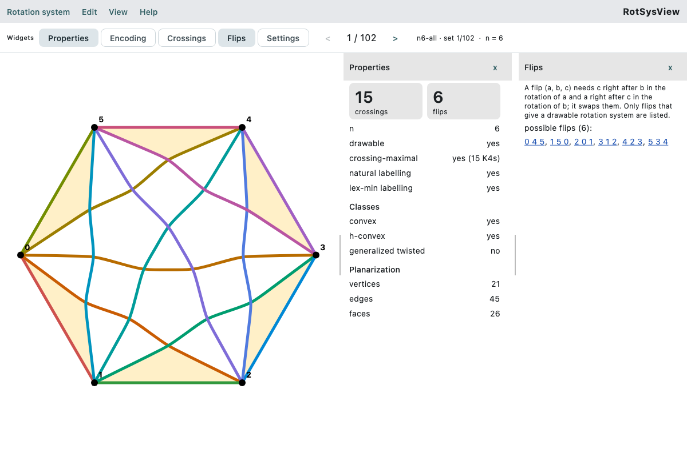
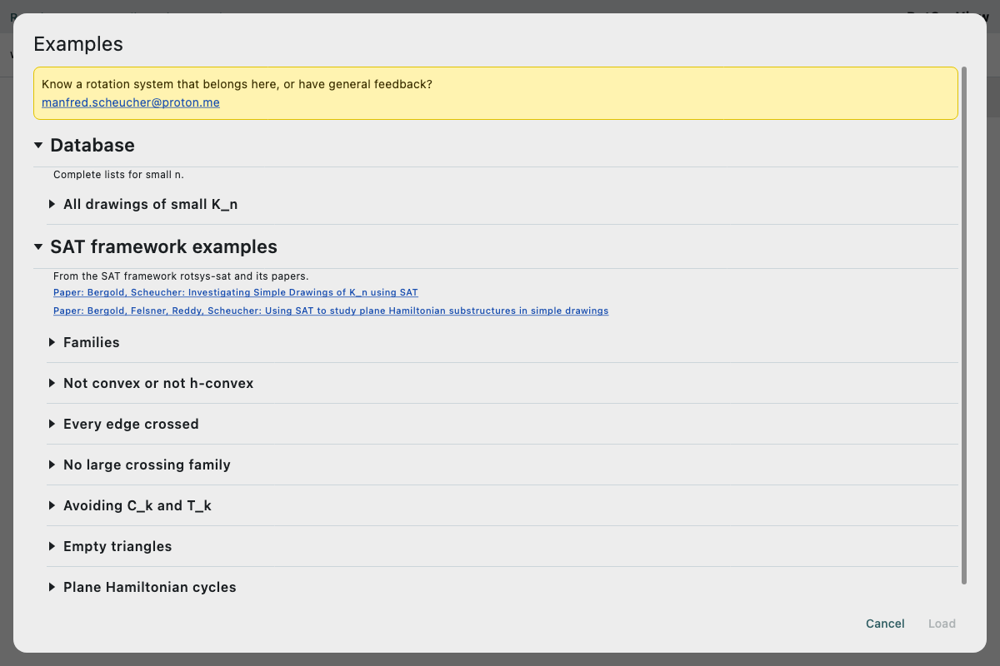
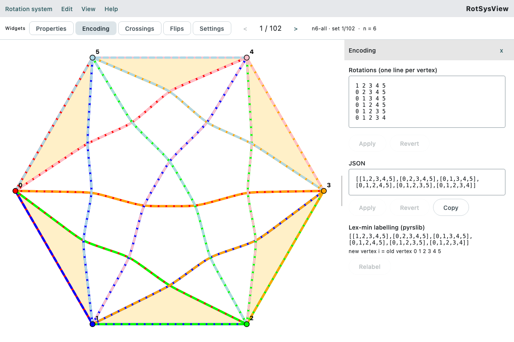

# RotSysView user manual

RotSysView is a viewer for rotation systems of complete graphs K_n, that is, for simple drawings of
K_n. It checks whether a rotation system can be drawn, draws it the way the sage programs pyrslib
`draw2.sage` and rotsys-sat `rotsys_draw.sage` do, shows its crossings and classes, and lets you change
it by flips. It runs in the browser (https://scheucher.dev/RotSysView/) and as a desktop app; both work
the same, except where this manual says otherwise.

## What you can do

- Load examples by what they show: the families C_n and T_n for any n you choose, all drawings of K_n
  for n = 4 to 7 (up to relabelling and mirroring), drawings that are not convex or not h-convex, drawings where
  every edge is crossed, drawings avoiding C_k and T_k, and more from the rotsys-sat repository.
- Paste and open rotation systems as rotation rows, JSON lines (as rotsys-sat prints them) or Lidický's
  data lines; save them as JSON or text; copy them.
- Browse files and example sets that hold several rotation systems, one at a time.
- Flip, by clicking a face or from a list; undo and redo.
- Choose the outer face of the drawing.
- See the numbers and classes of the rotation system: crossings, flips, drawable, crossing-maximal,
  natural and lex-min labelling, convex, h-convex, generalized twisted.
- See every crossing pair and the crossings per edge.
- Edit the rotation system as text and apply it; relabel it to pyrslib's lex-min labelling.
- Export a picture as SVG.
- Choose the drawing style, the colours, the line width and how the drawing is computed; most settings
  are remembered.

## Basics

- A rotation system of K_n gives, for every vertex, the counterclockwise order of its edges (that is, of
  the other vertices). Vertices are numbered from 0, as in pyrslib and rotsys-sat.
- A rotation system is drawable if it contains none of the obstructions Π4o, Π5,1o, Π5,2o (Bergold,
  Scheucher, Theorem 3). A system that is not drawable can still be loaded; it is shown without a
  drawing, with the obstruction it contains.
- The drawing is a planarization (every crossing becomes a vertex), embedded by an iterated Tutte
  embedding, with every edge a B-spline through its crossings (see [Settings](#settings)). It is
  computed in the background; until it is done, the canvas says "Computing the drawing ..." (after a
  change of the outer face or the layout settings the previous drawing stays). Drawings need n of at
  least 4.
- The outer face is drawn around the rest. By default it is the face with the fewest crossings (draw2),
  or a face of vertices only, else the largest (rotsys_draw).
- A flip (a, b, c) is possible when c comes right after b around a and a right after c around b. It
  swaps b and c around a, and a and c around b. RotSysView only offers the flips
  whose result is drawable.
- The faces at the corners of a possible flip are filled light yellow (not the outer face).

## The screen

- Menu bar: Rotation system, Edit, View, Help. On narrow screens it scrolls sideways. On the web, the
  app name is followed by "Rotation system viewer".
- Toolbar: the widget buttons, the arrows `<` `>` for files and example sets with several rotation
  systems, and the status: the name (with "set i/n", and "(modified)" after a change), n and the last
  message. Messages like "Flipped (0,1,2)" or "Saved …" fade after 3 s. When the row is full, the status
  moves to a line of its own.
- Canvas: the drawing.
- Widgets: Properties, Encoding, Crossings, Flips and Settings, next to or below the canvas. At the
  first start Properties and Flips are open.

RotSysView starts with the example set n6-all (all 102 drawings of K_6) at its first drawing.

At the first start a Welcome dialog says what rotation systems are; Examples opens the examples, Start
closes it, "Don't show again" turns it off. Errors (a file or text that cannot be read) open an Error
dialog.

The web version needs WebGL. Without it, RotSysView shows a note to turn on hardware acceleration in
the browser.

## Load rotation systems

All of these are in the Rotation system menu.

**Examples...** lists the bundled rotation systems in two supergroups, each split into groups. Every
supergroup and group can be opened; an open one starts with what it shows and links to the papers,
where there are some. The sets of a group are ordered by n. Closing the node that holds the selected
entry clears the selection.

- Database
  - All drawings of small K_n: every simple drawing of K_n for n = 4 to 7 up to relabelling and
    mirroring, 2, 5, 102 and 11556 drawings, enumerated with rotsys-sat. The counts are those of
    Aichholzer et al. (enumerated up to n = 8) and OEIS A276110.
- SAT framework examples (rotsys-sat; links to both SAT papers)
  - Families: Perfect convex C_n (n = 4 to 20) and Perfect twisted T_n (n = 4 to 18), generated for
    the n you choose (default 6) with `−` and `+` or by typing.
  - Not convex or not h-convex: the forbidden configurations of convex and h-convex drawings.
  - Every edge crossed: h-convex drawings in which every edge is crossed (n = 11 to 21, and two more).
  - No large crossing family, Avoiding C_k and T_k: drawings mostly from the SAT paper.
  - Empty triangles: Harborth's conjecture (at least 2n−4 empty triangles) and drawings without a
    lucky vertex. Plane Hamiltonian cycles: limits of stronger forms of Rafla's conjecture.

The selected entry shows its description, n, the number of rotation systems and where the data is from.
An entry with several rotation systems has "(k)" after its name and a number field with `−` and `+` to
choose one ("1 of 102"; a number out of range disables Load). Load opens the whole set at the chosen
member, so you can step through the others with `<` `>`. The dialog remembers its state while the app
runs. The yellow box has a mail address for sending interesting rotation systems or feedback (as in the
Welcome and About dialogs).

Some large examples cannot be drawn in time (see [Drawing problems](#drawing-problems)).

**Import...** reads pasted text, one or more rotation systems; the format is detected (see
[File formats](#file-formats)). The dialog lists the formats above the text field.

**Open file...** reads `.json`, `.json0` (rotsys-sat) and `.txt` files. On the web this uses the
browser's file picker, on the desktop a file chooser. The status then says "Opened <file>" (with the
number of rotation systems if there are several).

Loading is one undo step and fits the view.

### Several rotation systems

A file, a pasted text or an example set can hold several rotation systems. After loading, a notice says
how many were loaded ("Don't show again" turns it off). Then one is shown at a time:
the toolbar shows the arrows `<` `>` with "i / n" between them, and the status says "set i/n";
PageUp/PageDown (or `,` and `.`) do the same. Changes to one rotation system are kept when you switch to
another; switching clears the undo history and goes back to the default outer face.

### Unsaved changes

If the rotation system changed since it was loaded or saved, Load (Examples), Import and Open file first
ask "Save changes?": Save JSON or Save text saves and goes on, Discard goes on without saving, Cancel
stops. On the desktop, closing the window (or Cmd+Q) asks the same. The browser does not ask when you
close the tab. An unapplied edit in the Encoding widget is never saved: if it is the only change, the
dialog offers just Discard and Cancel. Switching to another rotation system of the set asks this only
for such an edit.

## View and navigate

- Zoom with the mouse wheel (at the pointer), by pinching, with `+`/`-`, or View → Zoom in / Zoom out.
- Pan by dragging, or with two fingers.
- Fit: View → Fit, Home or `0`.
- Loading, switching in a set and changing the style fit the view. Flips, Apply, Relabel, undo and redo
  do not. When the canvas changes size (window, widgets, dividers), the view keeps its centre and zoom.
- Pointing at an edge thickens it and names it ("edge {0,1}") in the lower left corner.
- Settings → Vertex numbers turns the numbers next to the vertices on and off.

## Flip

A click on a light yellow face flips. If several flips touch that face, a menu headed "Flip" lists them
("Flip 0 1 2", ...). The face under the mouse is shaded (not the outer face), and a "!" marks it when a
click flips there; for the outer face (a click outside the drawing) the "!" is in a corner of the
canvas.

Pointing at a menu entry highlights the three edges of the flip in orange and the faces at its corners
in yellow.

**Face menu**: right-click a face (long press on touch screens, Ctrl+click on a Mac) for a menu headed
"Face" (or "Face (outer face)"): its flips and Make outer face, which draws that face around the rest.
The desktop app has no long press.

Esc or a click outside closes a menu. Undo and Redo are in the Edit menu (Ctrl+Z, Ctrl+Shift+Z or
Ctrl+Y); they also take back Make outer face. A flip puts the outer face back to the default.

The Flips widget lists the same flips; see [Flips](#flips).

## Widgets and layout

The widget buttons in the toolbar and the View menu show and hide the widgets. The x in a widget's
title closes it.

- Wide window: each open widget is a column right of the canvas, in the order they were opened. Narrow
  window: they are stacked below the canvas. Layout auto/portrait/landscape in the View menu forces one
  of them; auto uses the width.
- All dividers between canvas and widgets can be dragged.
- At most Max. widgets (Settings, default 2) are open. Opening one more closes the one clicked least
  recently.
- If the window is too narrow for the canvas and the columns, the columns scroll sideways.

## Properties

The Properties widget shows the number of crossings and of possible flips in large digits, then:

| Value | Meaning |
|---|---|
| n | number of vertices |
| drawable | yes, or no with "contains <obstruction> on <vertices>" (then nothing else is shown) |
| crossing-maximal | every K4 has a crossing; the number of K4s in brackets |
| natural labelling | vertex 0 has the rotation 1, 2, ..., n-1 |
| lex-min labelling | the system is in pyrslib's lex-min labelling |

Classes (yes or no): convex, h-convex, generalized twisted (the forbidden configurations of
rotsys-sat). Below, once the drawing is there, the size of the planarization: vertices, edges, faces.

## Encoding

The Encoding widget shows the rotation system as text, in two forms:

- Rotations (one line per vertex): long lines scroll sideways.
- JSON: one line, `[[1,2,3],[0,2,3],...]`; Copy puts it on the clipboard.

Edit one and press Apply, or Revert to go back. Text that is not a rotation system opens an error dialog
with the reason, and the edit stays. Apply is one undo step. An unapplied edit survives closing the
widget.

Below, "Lex-min labelling (pyrslib)" shows the system in pyrslib's lex-min labelling and which old vertex
becomes which new one. Relabel switches to it (one undo step); it is disabled when the system is already
lex-min.

## Crossings

The Crossings widget lists every crossing pair, written `{a,b}×{c,d}` (edge {a,b} crosses edge {c,d}), and the
number of crossings per edge (`{a,b}: k`), then the number of uncrossed edges. Pointing at an entry
highlights its edges in the drawing. For a system that is not drawable it says "Not drawable."

## Flips

The Flips widget lists the possible flips as `a b c`. Click one to flip; pointing at one highlights its
edges and faces. Below, it says how many more flips would give a system that is not drawable. For a
system that is not drawable it says "Not drawable."

## Settings

The Settings widget has three groups and one "Reset to defaults" for all of them.

- Display: Style (pyrslib draw2, the default, or rotsys-sat rotsys_draw), Colour scheme, Line width (0.5
  to 8 px, default 5) and Vertex numbers.
  - draw2 colours every edge in its own colour and draws the vertices black.
  - rotsys_draw draws edge ab in the colour of a, dashed in the colour of b, and the vertices in their
    colours.
  - Colour scheme: "as the style" (the default: rainbow for draw2, Ipe for rotsys_draw), rainbow,
    rainbow2, Standard (12 colours) or "Ipe (rotsys_draw)" (17 colours). When there are more edges or
    vertices than Standard or Ipe has colours, rainbow is used instead (no colour twice).
- Widgets: Max. widgets (1 to 5, default 2).
- Layout, for the drawing only:
  - Planarization: "routing (default)", "SAT (rotsys_draw)" or "search (pyrslib draw2)". Routing inserts
    the edges one by one; SAT and the search are slow from n = 6 on.
  - Max. iterations (at least 1) and eps (a positive number, default 1e-10) of the Tutte iteration.
    Choosing a style also sets Max. iterations: 100 for draw2, 20 for rotsys_draw.

Changing the style also puts the outer face back to the default and fits the view.

Remembered for the next start (in the browser: per browser): all settings, the open widgets, the divider
positions, the layout and the "Don't show again" choice. Not remembered: the rotation system and the
Examples choices.

### Drawing problems

- Not drawable: the canvas says "Cannot draw: not drawable, it contains ..." and Properties names the
  obstruction.
- n below 4: "Cannot draw: n must be at least 4".
- Routing gives up after 15 s ("routing found no planarization within 15 s"). This happens for some
  of the large examples in Every edge crossed and Avoiding C_k and T_k.

Help → Visualization explains the planarization, the Tutte iteration and the outer face.

## Save and export

- **Save file...** (Rotation system menu): Save JSON or Save text writes all rotation systems of the
  file or set, including your changes. The desktop app opens a file chooser; the web app downloads the
  file. After saving, the rotation system counts as saved.
- On the desktop, saving over an existing file asks "<name> already exists. Replace it?"; No goes back
  to the file chooser.
- **Export...**: the shown rotation system as Rotations or JSON in a text field, with Copy. This does not
  count as saving.
- **Export SVG...** saves the drawing as shown (style, colour scheme, line width, vertex numbers, outer
  face) on a white square. It always contains the whole drawing, not the current zoom. It does not count
  as saving either.

## Help

The Help menu has short pages (General, Visualization, Widgets, Formats, Keyboard shortcuts) and About
RotSysView... (links to the web app and GitHub, literature with links, the build, license texts).

## Keyboard and mouse

| Key or gesture | Action |
|---|---|
| Esc | close the open menu |
| Ctrl+O | open a file |
| Ctrl+S | save to a file |
| Ctrl+Z | undo |
| Ctrl+Shift+Z or Ctrl+Y | redo |
| + / - | zoom in / out |
| Home or 0 | fit |
| PageUp or , | previous rotation system of the file or set |
| PageDown or . | next rotation system of the file or set |
| Click a light yellow face | flip (several flips: a menu) |
| Right-click or long press on a face | its menu |
| Drag | pan |
| Wheel or pinch | zoom |
| Two fingers | pan and zoom |

On a Mac, Cmd works like Ctrl and Ctrl+click like a right-click. The keys do nothing while you type in a
field or a menu is open (except Esc, Ctrl+O and Ctrl+S). On a Mac, Ctrl+O inside a text field inserts a
line break; use Cmd+O.

## File formats

- Rotations: one line per vertex 0, 1, ..., n-1 with its rotation, numbers separated by spaces or
  commas (pyrslib's `to_string`). Lines that use the numbers 1 to n are read as 1-based. Several systems
  are separated by an empty line, or each starts with a line holding n alone.
- JSON lines: `[[1,2,3],[0,2,3],[0,1,3],[0,1,2]]`, one system per line (rotsys-sat's output, pyrslib's
  `to_json_string`), 0-based.
- Lidický's lines: `4 0  1:432 2:431 3:412 4:123`, that is n, a number, then `vertex:rotation`, 1-based
  with one digit per vertex (the data of Balogh, Lidický, Salazar). Lines with n below 3 are skipped.
- JSON file: `{"name": ..., "rotation_systems": [[[1,2,3], ...], ...]}`, 0-based.

Save JSON writes such a JSON file, Save text one JSON line per rotation system. A file with several
rotation systems is loaded as a set; a JSON file with one rotation system gives it its name.
